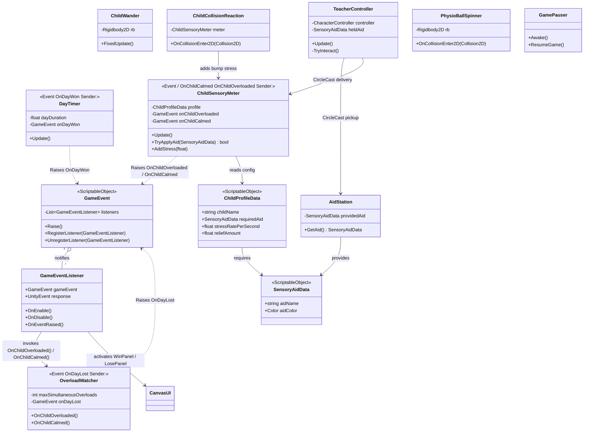

# Tiny Steps

**Tiny Steps** is a top-down 2D time-management and sensory-regulation game where the player takes on the role of a special education preschool teacher. The goal is to manage the daily classroom routine, observe each child's sensory stress level, and deliver the matching sensory aids before too many children become overloaded at the same time.

* **Play in Browser (itch.io):** https://elonitai.itch.io/tiny-steps
* **GitHub Repository:** https://github.com/CS-Ariel-GameDev-Project/Tiny-Steps

---

## How to Play & Run Instructions

### Controls & Objective
* **Move Teacher:** `WASD` or `Arrow Keys`
* **Pick Up / Deliver Sensory Aid:** `E` or `Space`
* **Visual Stress Indicator:** Each child's color shifts from **Green** (calm) to **Red** (overloaded).
* **Child Needs:**
  * **Omer** requires **Headphones** (from `Station_Headphones`)
  * **Noa** requires the **Weighted Blanket** (from `Station_Blanket`)
* **Win Condition:** Keep the classroom regulated until the day clock finishes.
* **Lose Condition:** Two children reach sensory overload simultaneously (colliding with other children also spikes stress).

### Running Locally in Unity
1. Clone the repository:
   ```bash
   git clone [https://github.com/CS-Ariel-GameDev-Project/Tiny-Steps.git](https://github.com/CS-Ariel-GameDev-Project/Tiny-Steps.git)
   ```
2. Open the project folder in **Unity Hub** (Unity 6 / 2D URP).
3. Open `Assets/Scenes/SampleScene.unity` and press **Play**.
4. Read the opening rules overlay (`StartPanel`) and click **Start Day** to begin.

---

## System Architecture & Class Diagram (Event Senders & Listeners)

**Tiny Steps** follows a **decoupled, event-driven, data-driven architecture** organized by responsibility under `Assets/Scripts/`:
* `Data/` — `ScriptableObject` definitions for child profiles (`ChildProfileData`) and sensory aids (`SensoryAidData`).
* `Events/` — `ScriptableObject` event channels (`GameEvent`) and scene-level subscribers (`GameEventListener`).
* `Player/` — Teacher 3D `CharacterController` movement and 2D `CircleCast` pickup/delivery (`TeacherController`).
* `Children/` — Sensory stress accumulation (`ChildSensoryMeter`), `Rigidbody2D` movement (`ChildWander`), and `OnCollisionEnter2D` bump reactions (`ChildCollisionReaction`).
* `Stations/` — Sensory aid dispensers (`AidStation`) and `AddTorque` interaction (`PhysioBallSpinner`).
* `Game/` — Day countdown (`DayTimer`) and simultaneous-overload tracking (`OverloadWatcher`).
* `UI/` — Start-screen pause control (`GamePauser`) and upright world-space text locking (`LockWorldRotation`).



---

## Architectural Choices (Alternatives & Reasons)

### 1. ScriptableObject `GameEvent` Channels vs. Direct References or Static C# Events
* **Chosen Approach:** `ScriptableObject` event assets (`OnDayWon`, `OnDayLost`, `OnChildOverloaded`, `OnChildCalmed`) paired with `GameEventListener` components that register in `OnEnable()` and unregister in `OnDisable()`.
* **Alternatives Considered:**
  1. *Direct Inspector references* from gameplay scripts (`DayTimer`, `OverloadWatcher`) to UI panels (`WinPanel`, `LosePanel`).
  2. *Static C# `event Action` delegates* on gameplay classes.
* **Reason:** Direct references tightly couple gameplay rules to UI objects, making scenes fragile when UI layouts change. Static C# events create hidden global dependencies and risk dangling subscriptions across scene reloads. `ScriptableObject` events keep gameplay logic completely decoupled from UI while allowing transparent wiring in the Inspector.

### 2. Data-Driven `ScriptableObject` Profiles vs. Hardcoded Character Subclasses
* **Chosen Approach:** Extracting per-child and per-item tuning data into `ChildProfileData` and `SensoryAidData` assets under `Assets/DataAssets/`.
* **Alternatives Considered:** Hardcoding stress rates and required aids inside `ChildSensoryMeter` or creating separate C# scripts per child (`OmerBehavior`, `NoaBehavior`).
* **Reason:** Per-character subclasses duplicate identical logic and violate the Open/Closed Principle. Storing configuration in `ScriptableObject` assets removes magic numbers from code and lets designers tune stress rates or add new profiles in the Inspector without recompiling.

### 3. Hybrid 3D `CharacterController` + 2D Physics Components
* **Chosen Approach:** Using a 3D `CharacterController` with static 3D child colliders for `Teacher` movement/wall blocking, alongside 2D physics (`Rigidbody2D`, `CircleCast`, `AddTorque`, `OnCollisionEnter2D`) for wandering children, sensory ball spin, interaction detection, and child-to-child bump stress.
* **Alternatives Considered:** Pure `Rigidbody2D` velocity movement for the player character.
* **Reason:** `CharacterController` gives crisp, deterministic top-down movement without physics bounce or sliding against classroom furniture, while 2D physics components model autonomous child wandering, rotational torque on the sensory physio ball, and collision-triggered stress spikes.

---

## Singletons & Static Variables Justification

* **Count:** **0 Singletons** and **0 mutable static variables**.
* **Reason:** A central `GameManager.Instance` singleton was intentionally avoided because it introduces hidden global coupling, makes testing harder, and concentrates unrelated responsibilities in one class. Instead, responsibilities are split across small single-purpose components (`DayTimer` for time, `OverloadWatcher` for lose-condition counting, `GamePauser` for start-overlay pausing) coordinated exclusively via `GameEvent` ScriptableObjects.

---

## Extensibility: Files Changed to Add a New Child or Sensory Aid

Adding a new sensory aid and a new child requires **0 changes to C# source files**:

1. **Create a new Sensory Aid asset (if introducing a new item):**
   * `Assets/DataAssets/Aid_<Name>.asset` *(created via `Assets -> Create -> TinySteps -> Sensory Aid`)*
2. **Create a new Child Profile asset:**
   * `Assets/DataAssets/Profile_<ChildName>.asset` *(created via `Assets -> Create -> TinySteps
